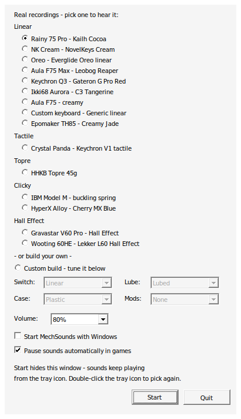

# MechSounds — Keyboard sounds for Windows

Your keyboard is thocky. Your noise-canceling headphones don't know that.
MechSounds plays a mechanical switch sound through your headphones on
every keypress, in every app, on any Windows PC with any keyboard.

This is the Windows answer to MechPad (a Mac-only app that makes switch
sounds through a MacBook trackpad). Same idea, different trick: instead
of trackpad haptics, MechSounds listens to your key presses system-wide and plays a recording of
a real mechanical switch to your normal audio output.



## Game-safe

Anticheat (BattleEye, Easy Anti-Cheat, Vanguard, VAC) flags global
keyboard hooks — they are how cheats intercept input. MechSounds
never reads game memory, never changes your input, and never injects
into a game, but the hook itself is what gets noticed. So it watches
the foreground window once a second: when a game is in front (a
known game executable, or any fullscreen window — including
borderless-windowed games), it **removes the keyboard hook entirely**
and the sounds stop. When you tab back to the desktop, the hook goes
back in and the sounds resume. No hook is installed while a game
runs, so there is nothing for anticheat to flag. The tray tooltip
says "(paused - game)" while it is paused. Untick **"Pause sounds
automatically in games"** in the chooser if you would rather it
never pause (the setting is remembered).

## Get it

[Download MechSounds v15](https://muse.ai/files/1323371437529100/29320095037601332/w0ngcz27rgl0lwrbru1a3d2y/MechSounds-v15.zip) — ready-to-run zip (exe + sounds).
Unzip it anywhere and double-click `MechSounds.exe` — the `sounds/`
folder must stay next to the exe.

Or build the exe from the source below.

## Build it

The app is a single C file. Build it with Zig (any recent version):

```sh
zig cc -target x86_64-windows-gnu -O2 -Wl,--subsystem,windows -o MechSounds.exe MechSounds.c -lwinmm -lgdi32 -lshell32 -lcomctl32 -lwininet -lmfplat -lmfreadwrite -lmfuuid -lole32
```

That produces a standalone `MechSounds.exe` — no installer, no
dependencies beyond stock Windows. Put it in a folder next to a
`sounds/` directory (see below) and double-click it.

## Use it

A chooser window opens first. The presets sit on tabs by switch
type — **Linear**, **Tactile**, **Topre**, **Clicky**, **Hall
Effect** — click a tab, then click a switch to hear it. Or pick
**Custom build** and tune your own: switch type (linear / tactile / clicky),
lubed or not, case material (plastic / aluminum / brass), and mods
(tape mod, o-rings, both, neither). The custom build starts from a
real recording of that switch type and shapes it to match — lube
and tape soften it, aluminum adds a bright ping, brass deepens it,
o-rings shorten the tail. Pick a volume and hit **Start**. The
window hides to the tray icon, and the sounds play from then on.
Your pick and volume are remembered for next time.

- **Start with Windows:** tick the checkbox in the chooser (or
  right-click the tray icon → "Start with Windows"). When it starts
  with Windows it skips the chooser and just starts playing with
  your last saved switch and volume.
- **Change switches later:** double-click the tray icon to reopen
  the chooser, or right-click it and pick a switch from the menu.
- **Add your own keyboard:** type your keyboard's name in the
  "Search MechVibes" box and hit **Search**. If MechVibes has a
  pack for that board, it shows up — double-click it to download,
  convert and install it as a new profile on the right tab. If
  that keyboard comes with different switch choices, they all
  show up and you pick the one you have. Added packs are
  remembered, so they stay in the list next time you open the app.

## Controls

Everything is on the tray icon — no keyboard shortcuts.

| Tray action | What it does |
|---|---|
| Right-click | Profiles, toggle, chooser, start-with-Windows, exit |
| Double-click | Reopen the chooser |

## Switch profiles

All fifteen are **real recordings** from [Mechvibes](https://mechvibes.com/sound-packs).
It starts on **Rainy 75 Pro** (the fullest sound).

| Profile | Character | MechVibes page |
|---|---|---|
| Rainy 75 Pro | Kailh Cocoa on a WOB Rainy 75 Pro — creamy thock | [Rainy 75 Pro](https://mechvibes.com/sound-packs/that-is-the-creamiest-i-ever-do-wtf-wob-rainy-75-pro-fr4-kailh-cocoa-by) |
| NK Cream | NovelKeys Cream — deep, smooth, marbly thock | [NK Cream](https://mechvibes.com/sound-packs/custom-sound-pack-1203000000038/) |
| Crystal Panda | Keychron V1 Crystal Panda — crisp tactile thock | [Mechvibes library](https://mechvibes.com/sound-packs) |
| Everglide Oreo | Oreo linear — clean, medium-deep thock | [EG Oreo](https://mechvibes.com/sound-packs/eg-oreo) |
| HHKB Topre 45g | Real Topre — soft, muted, deep thock | [HHKB Hybrid Topre](https://mechvibes.com/sound-packs/hhkb-hybrid-topre) |
| IBM Model M | Buckling spring — loud, metallic click-clack | [Mechvibes library](https://mechvibes.com/sound-packs) |
| Leobog Reaper | Aula F75 Max Leobog Reaper — creamy, full linear | [Aula F75 Max Reaper](https://mechvibes.com/sound-packs/aula-f75-max-leobog-reaper-switch) |
| Keychron Q3 | Gateron G Pro Red — smooth linear thock | [Keychron Q3](https://mechvibes.com/sound-packs/amazin-keychron-q3-bluex) |
| Ikki68 Aurora | C3 Tangerine — orange, creamy linear | [Orange deluxe](https://mechvibes.com/sound-packs/orange-deluxe) |
| Aula F75 | Aula F75 — creamy | [Aula F75](https://mechvibes.com/sound-packs/aula-f75) |
| Custom keyboard | Generic linear — clean, neutral linear | [Creamy thingy](https://mechvibes.com/sound-packs/creamy-thingy) |
| Gravastar V60 Pro | GravaStar Hall Effect — creamy magnetic | [Gravastar V60 Pro](https://mechvibes.com/sound-packs/gravastar-v60-pro-lubed) |
| HyperX Alloy | Cherry MX Blue — classic clicky | [HyperX Alloy](https://mechvibes.com/sound-packs/hyperx-alloy-cherry-mx-blue) |
| Wooting 60HE | Lekker L60 Hall Effect — smooth magnetic | [Wooting 60HE V2](https://mechvibes.com/sound-packs/wooting-60he-v2) |
| Epomaker TH85 | Creamy Jade linear — soft, creamy thock | [Epomaker Creamy Jade](https://mechvibes.com/sound-packs/epomaker-creamy-jade) |

Eight of these (Keychron Q3, Ikki68 Aurora, Aula F75, Custom
keyboard, Gravastar V60 Pro, HyperX Alloy, Wooting 60HE, Epomaker
TH85) are the rest of Mechvibes' 10 most-downloaded keyboard packs
— Rainy 75 Pro (#1) and Leobog Reaper (#4) were already in.

One click per press: a key plays one recording when you press it
and nothing when you let go — holding a key never re-triggers.
Each key has its own sound: every profile has 6 slightly different
recordings, and each key is assigned one of them, so the same key
always sounds the same and different keys sound like themselves
(pressing A over and over never changes its sound).
Spacebar, Enter, Backspace and Tab play the spacebar's own, deeper
recording (each pitch-shifted so the big keys sound distinct).

## Latency

This is built so the sound never lags behind your fingers:

- Playback is MCI: one `play <alias> from 0` command per keypress
  (no separate seek) on a pool of pre-opened aliases.
- The keyboard hook does one thing (pass the key along) and returns
  immediately, so the keystroke itself is never delayed by the sound.
- Every sound plays out fully and blends: each alias plays one
  sound at a time, so a keystroke never cuts off the previous
  sound mid-tail — fast typing blends instead of chopping,
  and no keypress is ever silently dropped.
- The sounds are rendered at 0.4 peak (-8 dBFS) so overlapping
  keypresses don't sum past 0 dBFS and distort in the mixer, and
  the exe has a volume control (chooser window) if you want them
  quieter still.
- The exe shows the measured hook-to-play dispatch time in its tray
  tooltip (avg/max ms). The rest is Windows audio output, typically
  10–30 ms — total stays well under the ~50 ms where typing starts
  to feel disconnected from its sound.

## Notes

- **Sound comes out of your default audio device.** If your
  noise-canceling headphones are the default output, that's where the
  thock goes. If sound comes out of your speakers instead, switch the
  default output to your headphones in Windows sound settings.
- **Any keyboard works** — USB, Bluetooth, laptop keyboard. It hears
  key events, not hardware, so swapping keyboards changes nothing.
- **Admin windows:** keys typed into apps running as administrator
  (Task Manager, some installers) won't make sounds unless you also
  run the app as administrator (right-click → Run as administrator).
- **Games:** it pauses itself automatically when a game is in
  front (see [Game-safe](#game-safe)) — no need to toggle it off
  by hand.

## Files

- `MechSounds.c` — the app. Builds with Zig (see above).
- `screenshot.png` — the chooser window, as shown above.
- `MechSounds.py` — same app as a Python script (stdlib only).
  Run `python MechSounds.py` next to a `sounds/` folder.
- `build_real_profiles.py` — converts Mechvibes packs in
  `real-packs/` into the `sounds/` profiles
- `synth_sounds.py` — the old script that synthesized switch sounds;
  kept for reference, no longer used (the synth profiles were
  replaced by real recordings in v6)
